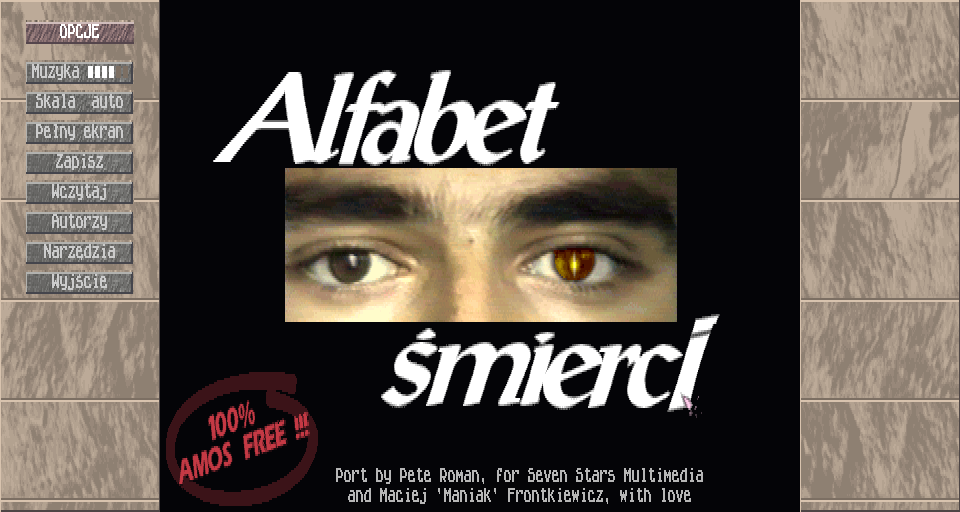
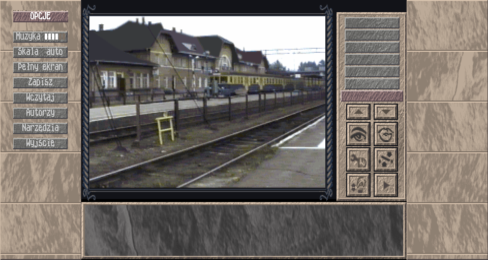
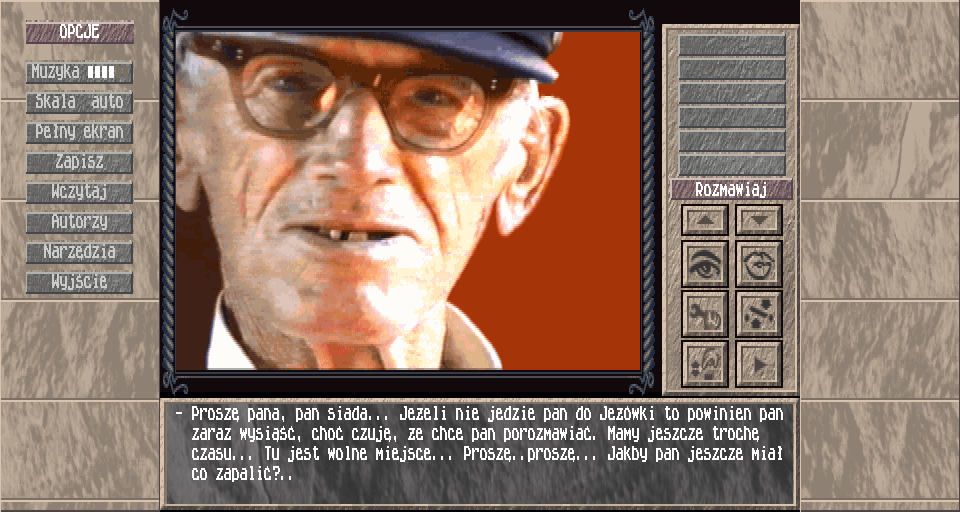

# Alfabet Śmierci: Amiga to PC port

**[Polski](#polski)** | **[English](#english)**

Port by Pete Roman, for Seven Stars Multimedia and Maciej 'Maniak' Frontkiewicz, with love.

---

## Polski

Polska przygodówka point-and-click z 1996 roku (Arte / Seven Stars Multimedia, Amiga AGA), przeniesiona na Windows. Port uruchamia **oryginalne dyskietki gry**: zdjęcia, palety, muzyka, teksty i logika są te same co na Amidze 1200. Nowy jest tylko silnik, który je czyta.

### Jak zagrać

1. Pobierz **`AlfabetSmierci-1.0.zip`** z zakładki [Releases](../../releases) albo całe repo: **Code**, potem **Download ZIP**.
2. Rozpakuj i wejdź do folderu **`AlfabetSmierci`**.
3. Uruchom **`AlfabetSmierci.exe`**.

Windows 10/11, 64 bit. Bez instalacji i bez uprawnień administratora. Folder `AlfabetSmierci` to kompletna gra: exe, oryginalne dyskietki (`data/disk1..4.adf`), logika gry (`data/scripts`), instrukcja `CZYTAJ.txt` i licencje bibliotek.

**Sterowanie:** wszystko lewym przyciskiem myszy (wybór, przejście, dialog, kolejna kwestia). Prawy przycisk i spacja przewijają kwestie jak w oryginale. FIRE joysticka, którego gra w kilku miejscach wymaga: lewy klik w puste miejsce obrazka, spacja, środkowy przycisk albo pad. F11 lub Alt+Enter: pełny ekran. Tab: panele boczne.

### Co jest w środku

- Obraz jak z układów AGA: bitplany, copper, sprite'y, blitter. Bez rozciągania i wygładzania, tylko całkowite powiększenie pikseli; piksel hires ma proporcje 1:2 jak na monitorze Amigi.
- Muzyka grana na żywo z oryginalnych modułów (The Player 6.0A, przełożone bezstratnie na ProTracker) przez libopenmpt z emulacją Pauli A1200. Żadnych nagranych wcześniej plików audio.
- Logika gry przełożona instrukcja po instrukcji z kodu 68000 na czytelne skrypty (`scripts/*.alf`, opis języka w `scripts/README.md`).
- Panele boczne na szerokim ekranie: opcje, szybki zapis, autorzy, narzędzia. Zapisy z menu gry działają na emulowanej dyskietce zapisu (`saves/stan_gry.adf`).

**Sprawdzone:** cała gra przechodzi automatem od dworca do zakończenia (263 kroki, także samym lewym przyciskiem), wszystkie lokacje przeszły testy, wybrane ekrany są identyczne bajt w bajt z oryginałem uruchomionym w WinUAE, tempo intro i 50 Hz zgodne z oryginałem.

### Dla programistów

| plik | co to jest |
|---|---|
| `ENGINE.md` | jak działa oryginał i jak działa port |
| `RECON.md` | format dyskietek, loader, CrunchMania, mapa pamięci |
| `STACK.md` | wybór technologii (C11, SDL3, libopenmpt) |
| `PROGRESS.md` | stan prac, tabela lokacji, komendy build/test |
| `CREDITS.md` | autorzy gry, port, narzędzia i licencje |
| `docs/WALKTHROUGH.md` | solucja wyprowadzona ze skryptów (spoilery!) |
| `src/` | silnik w C |
| `scripts/` | logika gry (generowana przez `tools/lifter.py` z dyskietki 1) |
| `tools/` | dekompresja, lifter, testy, porównania z WinUAE |
| `AlfabetSmierci/` | gotowa do gry wersja (wynik `build.sh`) |

Budowanie (Windows, Git Bash; wszystko lokalnie, nic systemowo):

    sh tools/fetch_deps.sh
    tools/toolchain/w64devkit/bin/sh tools/build_deps.sh
    tools/toolchain/w64devkit/bin/sh build.sh

Testy: `py tools/test_locations.py`, `py tools/playthrough.py` (szczegóły w `PROGRESS.md`).

### Prawa

Gra Alfabet Śmierci: (C) 1995/1996 Arte / Seven Stars Multimedia; programowanie Maciej 'Maniak' Frontkiewicz, grafika Ryszard 'Justus' Bagiński, muzyka i scenariusz Michał 'Dixan05' Prochownik. Gra jest dziś abandonware; obrazy dyskietek są dołączone w niezmienionej postaci. Kod portu (silnik, narzędzia, dokumentacja): licencja MIT, patrz [`LICENSE`](LICENSE). Biblioteki i ich licencje: [`CREDITS.md`](CREDITS.md) i `AlfabetSmierci/THIRD_PARTY_LICENSES.txt`.

---

## English

A Polish point-and-click adventure from 1996 (Arte / Seven Stars Multimedia, Amiga AGA), brought to Windows. The port runs the **original game disks**: the photographs, palettes, music, texts and game logic are the same as on the Amiga 1200. Only the engine that reads them is new. The game itself is in Polish.

### How to play

1. Download **`AlfabetSmierci-1.0.zip`** from [Releases](../../releases), or the whole repository: **Code**, then **Download ZIP**.
2. Unzip and open the **`AlfabetSmierci`** folder.
3. Run **`AlfabetSmierci.exe`**.

Windows 10/11, 64-bit. No installer, no administrator rights. The `AlfabetSmierci` folder is the complete game: the exe, the original disk images (`data/disk1..4.adf`), the game logic (`data/scripts`), a Polish readme (`CZYTAJ.txt`) and the library licences.

**Controls:** everything with the left mouse button (select, walk, pick a dialogue line, next line). The right button and space also move speech on, as in the original. Joystick FIRE, which the game asks for in a few places: left click on an empty spot of the picture, space, the middle button or a gamepad. F11 or Alt+Enter: fullscreen. Tab: side panels.

### What is inside

- AGA-accurate picture: bitplanes, copper, sprites, blitter. No stretching or filtering, integer scaling only; hires pixels keep the Amiga's 1:2 aspect.
- Music played live from the original modules (The Player 6.0A, converted losslessly to ProTracker) through libopenmpt with A1200 Paula emulation. No pre-rendered audio.
- The game logic translated instruction by instruction from the 68000 code into readable scripts (`scripts/*.alf`, language described in `scripts/README.md`).
- Side panels on wide screens: options, quick save, credits, tools. The game's own save menu works on an emulated save disk (`saves/stan_gry.adf`).

**Verified:** the whole game is played through by a bot from the first location to the ending (263 steps, also with the left button only), every location passes the tests, selected screens are byte-identical to the original running in WinUAE, and the intro timing and the 50 Hz pacing match the original.

### For developers

Engine in C11 with SDL3 and libopenmpt, built with a portable MinGW-w64 toolchain (see `STACK.md`). Docs (mostly English): `ENGINE.md` (how the original and the port work), `RECON.md` (disk format, loader, CrunchMania, memory map), `CREDITS.md`. Working notes `PROGRESS.md` and `CLAUDE.md` are in Polish. Build:

    sh tools/fetch_deps.sh
    tools/toolchain/w64devkit/bin/sh tools/build_deps.sh
    tools/toolchain/w64devkit/bin/sh build.sh

### Rights

Alfabet Śmierci: (C) 1995/1996 Arte / Seven Stars Multimedia; code Maciej 'Maniak' Frontkiewicz, graphics Ryszard 'Justus' Bagiński, music and story Michał 'Dixan05' Prochownik. The game is abandonware today; the disk images are included unmodified. The port's code (engine, tools, documentation) is MIT licensed, see [`LICENSE`](LICENSE). Third-party libraries and their licences: [`CREDITS.md`](CREDITS.md) and `AlfabetSmierci/THIRD_PARTY_LICENSES.txt`.

The port was made with Claude (Anthropic); access to the tools was possible thanks to the cooperation with ReadyM (ReadyCode Limited).
